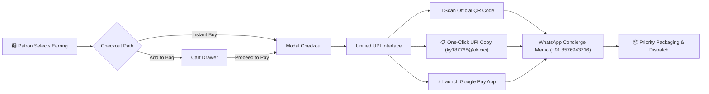

<div align="center">

# 👑 Aura Jewels &mdash; Elegant Earrings Atelier
### *Haute Joaillerie & Handcrafted Royal Earring Collections*

[](#)
[](#)
[](#)
[](#)
[](https://github.com/Priyanshu-kumar-maurya)

<br/>

> **"Adorning Grace with Heritage Kundan, Sparkling Austrian Crystals, and Certified 925 Sterling Silver."**  
> An ultra-luxurious, responsive e-commerce web application meticulously engineered with vanilla web technologies, dynamic bag state management, instantaneous category/search filtering, and a unified UPI & WhatsApp checkout engine.

<br/>

[✨ Explore Live Collection](#-collection-showcase) &bull;
[🛒 Bag & Checkout Flow](#-payment--checkout-architecture) &bull;
[⚡ Tech Architecture](#-technology-stack) &bull;
[🚀 Quick Start](#-quick-start--local-setup) &bull;
[📫 Atelier Concierge](#-artisan-profile--connect)

</div>

---

## 🌟 Atelier Overview

**Aura Jewels** is a luxury digital storefront dedicated to handcrafted, hypoallergenic earrings. Built for modern connoisseurs of fine jewelry, the application marries heritage royal aesthetics (Obsidian `#07090e` and Champagne Gold `#d4af37`) with blistering web performance and fluid mobile ergonomics.

Every product is enriched with verified hallmarking information, anti-tarnish micro-seal standards, dimensional specifications, and real-time inventory pricing with festive coupon integration (`ROYAL20`).

---

## ✨ Key Architectural Highlights

| Feature | Description |
| :--- | :--- |
| 🌙 **Dual Luxury Themes** | Instant switch between **Obsidian Royal Night** (deep OLED dark with champagne accents) and **Pearl Ivory Daylight** with zero flash of unstyled content (`localStorage` persistence). |
| 🛍️ **Interactive Cart Drawer** | Slide-out shopping bag drawer featuring dynamic item quantity steppers, live subtotal computation, automatic free shipping unlocks, and real-time 20% festive discount deductions. |
| 🔍 **Live Search & Instant Filter** | Filter 24 distinct masterpieces across **Royal Kundan**, **Austrian Crystals**, **Lustrous Pearls**, **Emerald Danglers**, and **Contemporary Hoops** with keyword lookup. |
| ⚡ **Multi-Criteria Sorting** | Live DOM sorting by Price (Low to High, High to Low), Alphabetical (A - Z), and Curated Featured status. |
| 👁️ **Quick View Modal** | Inspect high-resolution imagery, dimensions, hypoallergenic certifications, and style tags with an interactive quantity stepper before committing to buy. |
| 💳 **Unified Direct UPI Checkout** | Embedded merchant QR Code scan (`QR code.jpg`), one-click verified UPI copy (`ky187768@okicici`), Google Pay direct intent launch, and WhatsApp concierge payload generation. |
| ❤️ **Persistent Wishlist** | Save curated styles with interactive heart animations remembered across browsing sessions. |
| 💬 **Concierge WhatsApp Integration** | Instant pre-filled order confirmation memo sent directly to the artisan concierge desk with item breakdown, customer phone, and shipping address. |
| 📱 **Zero Framework Overhead** | 100% lightweight vanilla HTML5, modern CSS3 custom properties, and modular JavaScript without bulky library dependencies. |

---

## 💎 Curated Collection Showcase (24 Masterpieces)

The store preserves and elevates all 24 authentic handcrafted designs:

```
├── 01. Crystal Drop Earrings      (₹299) — Austrian crystal in sterling silver
├── 02. Gold Hoops                 (₹299) — 18K micro gold vermeil plating
├── 03. Pearl Studs                (₹239) — Cultured freshwater pearls & 925 silver
├── 04. Antique Danglers           (₹399) — Heritage oxidized silver filigree
├── 05. Emerald Drops              (₹249) — Lab-grown royal emerald teardrops
├── 06. Diamond Studs              (₹299) — Fire & brilliance cubic zirconias
├── 07. Ruby Teardrops             (₹209) — Pigeon blood crimson stones
├── 08. Silver Hoops               (₹399) — Pure hallmarked 925 sterling silver
├── 09. Rose Gold Drops            (₹209) — Blushing copper-gold alloy finish
├── 10. Sapphire Danglers          (₹239) — Midnight kashmir blue stones
├── 11. Emerald Royal Danglers     (₹209) — Festival bestseller showpiece
├── 12. Vintage Pearl Drops        (₹209) — Baroque pearl drops with vintage caps
├── 13. Minimalist Studs           (₹249) — Everyday featherlight geometric studs
├── 14. Chandelier Earrings        (₹209) — Multi-tier bridal statement earrings
├── 15. Geometric Danglers         (₹209) — Art-deco brushed metallic silhouettes
├── 16. Floral Studs               (₹209) — Enamel-inlaid delicate blossom petals
├── 17. Threader Earrings          (₹209) — Sleek pull-through Venetian chains
├── 18. Tribal Hoops               (₹209) — Hand-stamped bohemian nomadic rings
├── 19. Kundan Jhumkas             (₹209) — Hand-set glass polki with tiny pearls
├── 20. Statement Studs            (₹209) — Architectural oversized runway piece
├── 21. Huggie Hoops               (₹209) — Snug lobe-hugging daily pavé hoops
├── 22. Tassel Earrings            (₹209) — Silken micro-chain cascading drops
├── 23. Boho Feathers              (₹209) — Finely etched feather filigree
└── 24. Crystal Bloom              (₹299) — Pavé crystal floral cluster studs
```

---

## 💳 Payment & Checkout Architecture



---

## 🛠️ Technology Stack

- **Markup:** Semantic HTML5, ARIA Accessible landmarks, OpenGraph & SEO Meta Tags
- **Styling:** CSS3 Variables (Design Tokens), Glassmorphism Backdrop Filters, Bento Grids, CSS Grid & Flexbox
- **Typography:** *Playfair Display* (Editorial Headings), *Plus Jakarta Sans* (Body Text), *JetBrains Mono* (Prices & Codes)
- **Icons:** Font Awesome 6.5 Free SVG/Font kit
- **Scripting:** Modular ES6+ JavaScript (Event delegation, Web Storage API, DOM Mutation, Clipboard API, URL Intent schemes)
- **Zero Build Toolchain:** Runs natively in any evergreen web browser without bundlers or node servers.

---

## 🚀 Quick Start & Local Setup

### 1. Clone the Repository
```bash
git clone https://github.com/Priyanshu-kumar-maurya/Earrings-shop.git
cd Earrings-shop
```

### 2. Launch in Browser
No compilation or external dependencies are required. Simply open `index.html` in your favorite browser:

```bash
# On Windows PowerShell
Start-Process index.html

# On macOS
open index.html

# On Linux
xdg-open index.html
```

Or serve via any static file server:
```bash
# Python 3
python -m http.server 8080

# Node / npx
npx serve .
```

---

## 📁 Repository Structure

```
Earrings-shop/
├── index.html               # Luxury storefront single-page application
├── styles.css               # Obsidian & Pearl Ivory responsive luxury design system
├── script.js                # Core state engine (Cart, Wishlist, Filter, UPI, WhatsApp)
├── login.html               # Patron authentication portal
├── profile.html             # Customer dashboard & order history
├── QR code.jpg              # Official merchant payment QR code
├── QR code1.jpg             # High-res backup QR code
├── image.png                # Product 01 asset
├── image copy.png           # Spotlight asset
├── image copy 2.png - 23.png# Products 02 through 24 assets
└── README.md                # Atelier documentation & engineering guide
```

---

## 👤 Artisan Profile & Connect

Engineered with precision and elegance by **Priyanshu Kumar Maurya**.

[](https://www.linkedin.com/in/priyanshu-kumar-maurya-808718281/)
[](https://github.com/Priyanshu-kumar-maurya)
[](https://www.instagram.com/codexs_priyanshu/)
[](https://priyanshu-kumar-maurya.github.io/Bio/)
[](https://wa.me/918576943716)

---

<div align="center">
  <sub>&copy; 2026 Aura Jewels / Elegant Earrings. Handcrafted with passion.</sub>
</div>
